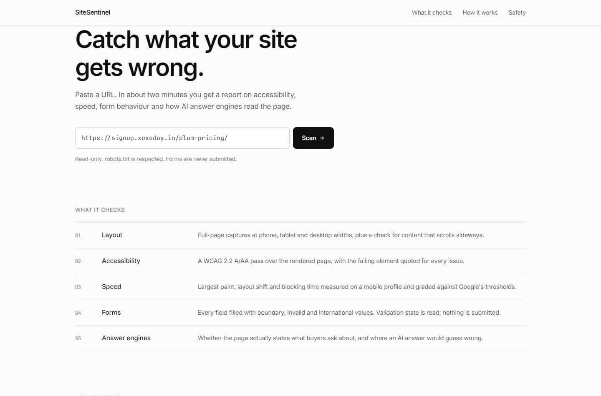
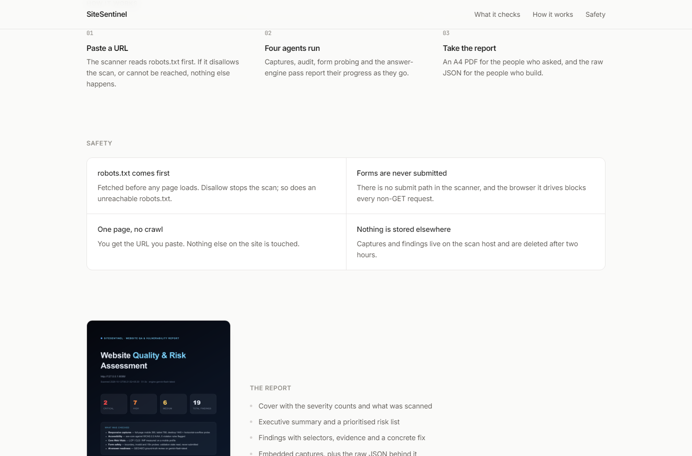

# SiteSentinel — Website Vulnerability & QA Scanner

Paste a URL. Four headless agents capture, audit, probe and interrogate the site, and you
get an executive A4 report plus the structured JSON it was built from.



Paper and ink, hairline rules, colour reserved for severity — no gradient washes, no
badges naming the tools, no filler copy. During a scan the progress view shows the **actual
capture of the target page** as soon as the first stage finishes, alongside live issue
counts. All motion collapses under `prefers-reduced-motion`. See
[Design](docs/Design.md).

---

## The four agents

One orchestrator opens a single headless Chromium and fans out to four specialists.
Each agent owns its own evidence, its own guardrails and its own findings.

```
                         ┌──────────────────────────┐
                         │       Orchestrator       │
                         │ robots → throttle → 5    │
                         │ stages → dedupe → PDF    │
                         └────────────┬─────────────┘
        ┌───────────────┬─────────────┴───────────┬───────────────┐
   ┌────▼─────┐   ┌─────▼──────┐           ┌──────▼─────┐   ┌─────▼──────┐
   │ Capture  │   │   Audit    │           │   Guard    │   │   Intel    │
   │ Agent    │   │   Agent    │           │   Agent    │   │   Agent    │
   ├──────────┤   ├────────────┤           ├────────────┤   ├────────────┤
   │ screens  │   │ a11y       │           │ forms      │   │ geo / aeo  │
   │ + overflow│  │ + vitals   │           │ (no submit)│   │ + vision   │
   └──────────┘   └────────────┘           └────────────┘   └────────────┘
```

| Agent | Stage keys | Engines | Produces |
|---|---|---|---|
| **Capture** | `screenshots` | Playwright, Chromium, Pillow | full-page mobile 390 / tablet 768 / desktop 1440 captures, JPEG thumbnails, horizontal-overflow probe per viewport |
| **Audit** | `accessibility`, `vitals` | axe-core 4.10, Lighthouse CLI | WCAG 2.2 A/AA violations with selector + snippet evidence; LCP / CLS / INP / TBT / perf score graded against Google thresholds |
| **Guard** | `forms` | Playwright + three guardrail layers | boundary, invalid and i18n probe results read from the DOM's own validation state — **never submitted** |
| **Intel** | `ai` | `gemini-flash-latest` (multimodal) | buyer-question gaps, claims an AI answer engine would get wrong, visual review of the desktop capture, executive summary |

Then the engine deduplicates findings, counts them by severity, and renders
`report.pdf` (A4) + `report.json` from the same in-memory result — the PDF and the raw
artifact can never disagree.



---

## Quick start

```powershell
python -m pip install -r requirements.txt
python -m playwright install chromium
npm install                       # provides node_modules/axe-core/axe.min.js
python -m uvicorn server:app --port 8080
# → http://127.0.0.1:8080/
```

`GEMINI_API_KEY` can come from the environment or a local `.env`. Without it the Intel
agent degrades to a clearly-labelled *"AI layer disabled"* finding and the other four
stages still run — a scan never fails because of a missing key.

Lighthouse is optional locally. If the `lighthouse` binary (or `npx`) is unavailable the
Audit agent falls back to an in-page `PerformanceObserver` lab measurement and reports
the stage as `degraded` instead of failing.

---

## Verify the whole flow

```powershell
# terminal 1 — a local target with intentional defects
python -m http.server 8099 --directory tests/fixture_site

# terminal 2 — the scanner (dev-only flag allows loopback targets)
$env:SITESENTINEL_ALLOW_PRIVATE_TARGETS = "1"
python -m uvicorn server:app --port 8080

# terminal 3 — landing → scan → SSE progress → results → PDF → JSON
python scripts/verify_e2e.py http://127.0.0.1:8080 http://127.0.0.1:8099/
```

The verifier asserts the product contract: the landing page and every static asset
serve, all five stages report, no stage hard-fails, findings are deduplicated, severity
counts add up, **`forms_submitted == 0`**, three viewports are captured, a real
multi-page A4 PDF downloads, and the JSON artifact and evidence captures serve.

Offline unit tests (no network, no browser):

```powershell
python -m pytest        # 11 tests, including a static proof that no submit path exists
```

---

## API

| Method | Path | Purpose |
|---|---|---|
| `GET` | `/` | the SPA (landing → progress → results) |
| `POST` | `/api/scan` | `{"url": "..."}` → `{"scan_id": "..."}` |
| `GET` | `/api/scan/{id}/events` | Server-Sent Events progress stream |
| `GET` | `/api/scan/{id}` | job status + full result JSON |
| `GET` | `/api/scan/{id}/report.pdf` | A4 PDF report |
| `GET` | `/api/scan/{id}/report.json` | structured findings JSON |
| `GET` | `/api/scan/{id}/shot/{name}` | evidence capture (`mobile.jpg`, `desktop.png`, …) |
| `GET` | `/api/health` | liveness + capability probe (model, axe-core, AI key, flags) |

Deep link: `/?url=https://example.com/` starts a scan immediately — handy for demos and CI.

---

## Safety model

* **robots.txt, fail-closed.** Fetched with the honest User-Agent before any page load.
  `Disallow` wins; a network error, timeout or 5xx **refuses the scan** rather than
  guessing. A 404 (no robots file) is allow-all per RFC 9309.
* **Honest, contactable User-Agent** — `SiteSentinelBot/1.0 (+https://xoxoday.com/sitesentinel; contact: qa-ops@xoxoday.com) Quality-Scanner`,
  used for every request the scanner makes.
* **1.5s throttle** on every request to the target origin (`app/ratelimit.py`).
* **Forms are never submitted — enforced in three independent layers:**
  1. `app/stages/forms.py` contains no call to `submit()` / `requestSubmit()`, and a unit
     test proves it statically by walking the module's AST;
  2. an init script stubs `HTMLFormElement.prototype.submit` / `requestSubmit` and cancels
     every `submit` event in the capture phase;
  3. the browser context aborts every non-GET request, so nothing can leave the machine
     even if a page script tried.
* **SSRF guard** — non-HTTP schemes, loopback, private ranges, link-local and cloud
  metadata hosts are rejected before a browser is launched.
  `SITESENTINEL_ALLOW_PRIVATE_TARGETS=1` is a dev/CI-only escape hatch.
* **No third-party data.** Findings stay under `runs/<scan_id>/` on the scan host and are
  swept after `JOB_TTL_SECONDS` (2 hours).

## AI layer policy

Every AI layer — GEO/AEO ground-truth review, visual QA on the desktop capture, and the
executive synthesis — runs on **`gemini-flash-latest`** and nothing else. No Gemini Pro,
no other provider, no fallback model. One `GEMINI_API_KEY` drives all of it
(`app/llm.py`, JSON response mode, temperature 0.2, bounded retries). If a synthesis call
fails, the report falls back to a deterministic summary so it is always complete.

## Reproducibility

Findings carry deterministic IDs (`sha1(category | rule | selector …)`), duplicates are
collapsed, and results sort by severity then category — two scans of an unchanged page
yield the same finding set.

---

## Deploy

The engine needs a real Chromium, the Lighthouse CLI, a writable artifact directory and a
multi-minute budget, so it runs in a container. The UI is plain static files and is happy
anywhere — including Vercel.

```bash
# engine → Cloud Run
gcloud builds submit --tag gcr.io/$PROJECT/sitesentinel
gcloud run deploy sitesentinel --image gcr.io/$PROJECT/sitesentinel \
  --region asia-south1 --allow-unauthenticated \
  --memory 2Gi --cpu 2 --timeout 900 \
  --set-env-vars GEMINI_API_KEY=your-key,SITESENTINEL_ALLOWED_ORIGINS=https://your-ui.vercel.app
```

```bash
# UI → Vercel (static bundle in static/, no build framework)
vercel --prod
# set SCANNER_API_ORIGIN=https://sitesentinel-xxxx.run.app in the Vercel project
```

Full walkthrough, environment variables and troubleshooting: **[docs/DEPLOYMENT.md](docs/DEPLOYMENT.md)**.

---

## Configuration

| Variable | Default | Meaning |
|---|---|---|
| `GEMINI_API_KEY` | – | enables the Intel agent (all AI layers) |
| `SITESENTINEL_ALLOWED_ORIGINS` | `*` | comma-separated CORS origins for the API |
| `SITESENTINEL_ALLOW_PRIVATE_TARGETS` | `0` | dev/CI only: allow loopback + private targets |
| `SCANNER_API_ORIGIN` | – | Vercel build-time API base written into `app-config.js` |
| `PORT` | `8080` | container listen port |

Politeness, budgets, thresholds and viewports live in `app/config.py`.

---

## Layout

```
server.py                 FastAPI app: routes, SSE, downloads, CORS, SSRF guard
app/
  config.py               identity, throttle, model, stage budgets, CWV thresholds
  models.py               Finding / ScanResult, dedup, severity counts
  engine.py               orchestrator: stage order, per-stage guards, artifacts
  jobs.py                 in-process job registry, SSE fan-out, TTL sweep
  robots.py               robots.txt with fail-closed policy
  ratelimit.py            per-origin 1.5s throttle
  llm.py                  the single gemini-flash-latest client
  synthesis.py            executive summary + top risks (deterministic fallback)
  report.py               A4 PDF renderer (HTML + CSS → Chromium page.pdf)
  stages/
    browser.py            context factory: UA, viewport, guardrail hooks
    screenshots.py        Capture agent
    accessibility.py      Audit agent — axe-core WCAG 2.2 A/AA
    vitals.py             Audit agent — Lighthouse CLI + observer fallback
    forms.py              Guard agent — probing with the no-submit guardrail
    geo_aeo.py            Intel agent — ground truth + multimodal review
static/                   landing / progress / results SPA (no build step)
  index.html app.css app.js app-config.js img/
scripts/verify_e2e.py     end-to-end verification of the full user flow
scripts/build-vercel.mjs  writes app-config.js from SCANNER_API_ORIGIN at build time
tests/test_scanner_core.py  offline unit tests
tests/fixture_site/       local target with intentional defects
```

Docs: [PRD](docs/PRD.md) · [Architecture](docs/Architecture.md) · [Design](docs/Design.md) ·
[Deployment](docs/DEPLOYMENT.md) · [Rules](docs/Rules.md) · [Phases](docs/Phases.md) ·
[Memory](docs/Memory.md)
